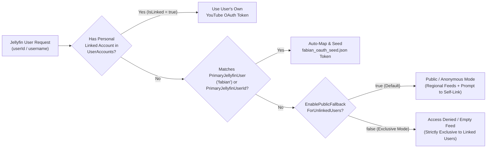

<div align="center">

# 📺 Jellyfin YouTube & YouTube Music Plugin (`Jellyfin.Plugin.YouTube`)

**A 1:1 SmartTube Android TV & YouTube Music Replacement Built Natively into Jellyfin 10.11+**

[](https://dotnet.microsoft.com/)
[](https://jellyfin.org/)
[](https://developers.google.com/youtube/v3)
[](https://music.youtube.com/)
[](https://sponsor.ajay.app/)
[](https://returnyoutubedislike.com/)
[](https://www.gnu.org/licenses/gpl-3.0)

*Transform Jellyfin into a full-featured, ad-free **SmartTube** and **YouTube Music** media center across Android TV, Fire TV, Apple TV, Web, iOS, and Desktop — complete with per-user OAuth 2.0 TV Device Code login, native Jellyfin TV & Music libraries (`Shows`, `Suggestions`, `Upcoming`, `Playlists`, `Collections`, `Albums`, `Artists`), server-side SponsorBlock auto-skip, ReturnYouTubeDislike ratings, and zero-storage `.strm` HLS/M4A proxy streaming.*

</div>

---

## 📖 Table of Contents

1. [Overview & Core Philosophy](#-overview--core-philosophy)
2. [System Architecture](#-system-architecture)
3. [Key Features Breakdown](#-key-features-breakdown)
   - [1. 1:1 SmartTube Video Experience (Native Library + Channel)](#1-11-smarttube-video-experience-native-library--channel)
   - [2. Native Jellyfin Library Tabs Mapping (`Shows`, `Suggestions`, `Upcoming`, `Playlists`, `Collections`)](#2-native-jellyfin-library-tabs-mapping-shows-suggestions-upcoming-playlists-collections)
   - [3. Full YouTube Music Integration (Audio Library, Channel, Playlists & Web Player)](#3-full-youtube-music-integration-audio-library-channel-playlists--web-player)
   - [4. Multi-User OAuth 2.0 TV Device Code Auth & Access Control](#4-multi-user-oauth-20-tv-device-code-auth--access-control)
   - [5. Zero-Error HLS Video & M4A Audio Proxy Engine](#5-zero-error-hls-video--m4a-audio-proxy-engine)
   - [6. Dual-Layer SponsorBlock Auto-Skip (Server + Client)](#6-dual-layer-sponsorblock-auto-skip-server--client)
   - [7. ReturnYouTubeDislike (RYD) & Two-Way Interactions](#7-returnyoutubedislike-ryd--two-way-interactions)
   - [8. Local Media Archives & Offline Metadata Integration](#8-local-media-archives--offline-metadata-integration)
4. [Complete Configuration Reference (`PluginConfiguration`)](#-complete-configuration-reference-pluginconfiguration)
   - [General, Authentication & Multi-User Access Settings](#general-authentication--multi-user-access-settings)
   - [Video Playback, SponsorBlock & Interaction Settings](#video-playback-sponsorblock--interaction-settings)
   - [YouTube Video Library & `.strm` Sync Settings](#youtube-video-library--strm-sync-settings)
   - [YouTube Music Integration Settings](#youtube-music-integration-settings)
   - [Network, Proxy & `yt-dlp` Extraction Settings](#network-proxy--yt-dlp-extraction-settings)
   - [Per-User OAuth Account Model (`YouTubeUserAccountEntry`)](#per-user-oauth-account-model-youtubeuseraccountentry)
5. [Native Jellyfin Providers, Channels & Services](#-native-jellyfin-providers-channels--services)
6. [Scheduled Tasks Reference](#-scheduled-tasks-reference)
7. [REST API Endpoints Reference (`/api/youtubePlugin/*`)](#-rest-api-endpoints-reference-apiyoutubeplugin)
8. [On-Disk `.strm` Directory Structure](#-on-disk-strm-directory-structure)
9. [Installation, Deployment & Building from Source](#-installation-deployment--building-from-source)
10. [Troubleshooting & Diagnostics](#-troubleshooting--diagnostics)

---

## 🌟 Overview & Core Philosophy

Standard YouTube plugins for Jellyfin typically rely on downloading gigabytes of video files to disk or provide barebones channel folders that fail to populate native Jellyfin library views.

**`Jellyfin.Plugin.YouTube`** is engineered from the ground up on the same architectural standard as [`crunchyroll-jellyfin`](https://github.com/FaserF/crunchyroll-jellyfin) to serve as a **complete 1:1 replacement for SmartTube (Android TV) and YouTube Music**:

- **Zero Disk Footprint:** Videos and music tracks are represented as lightweight `<100 byte` `.strm` pointer files and live Channel items. Media streams are resolved on-demand at playback time.
- **100% Native Jellyfin UI Utilization:** Every tab inside Jellyfin's **YouTube** (`tvshows`) and **YouTube Music** (`music`) libraries is meaningfully populated — including **Shows**, **Suggestions**, **Upcoming**, **Playlists**, **Collections**, **Artists**, **Albums**, and **Songs**.
- **True Multi-User Isolation with Seamless Fallback:**
  - The configured primary Jellyfin user (default: `fabian`) is automatically linked to the primary Google/YouTube OAuth 2.0 account via an embedded/persisted seed token (`fabian_oauth_seed.json`).
  - Every other Jellyfin user can either **link their own personal YouTube / YouTube Music account** directly inside the Jellyfin Web UI (`google.com/device` QR/code flow) or **browse and stream immediately via the Public/Anonymous fallback** (or be restricted completely if `EnablePublicFallbackForUnlinkedUsers = false`).
- **Universal Client Compatibility:** Works out of the box on **Jellyfin for Android TV**, **Findroid**, **Swiftfin**, **Infuse**, **Kodi**, and **Jellyfin Web** without requiring client-side patches.

---

## 🏗 System Architecture

```mermaid
flowchart TD
    subgraph Clients["Jellyfin Clients (Android TV, Web, Mobile, Desktop)"]
        ATV["📺 Jellyfin Android TV / SmartTV"]
        WEB["🌐 Jellyfin Web SPA + youtubePlugin.js"]
        MOB["📱 Mobile / Finamp / Symfonium (Music)"]
    end

    subgraph Core["Jellyfin Server 10.11+ (Jellyfin.Plugin.YouTube)"]
        STARTUP["🚀 YouTubeStartupService\nAuto-Provisions Libraries, Seeds OAuth, Injects JS"]
        CTRL["🔌 YouTubePluginController\n(/api/youtubePlugin/*)"]
        MSP["🎞️ YouTubeMediaSourceProvider\n(Dynamic Video HLS & Audio M4A MediaSources)"]
        CH_VID["📺 YouTubeChannel\n(SmartTube Live Categories + Search)"]
        CH_MUS["🎵 YouTubeMusicChannel\n(Dedicated Audio Channel)"]
        SYNC_STRM["⏱️ SyncYouTubeStrmTask\n(Video & Music .strm Generator)"]
        SYNC_PL["📋 YouTubePlaylistAndCollectionSyncService\n(Native Jellyfin Playlists & BoxSets)"]
        SYNC_HIST["🔄 SyncWatchHistoryTask\n(YouTube FEhistory -> Jellyfin UserData)"]
        SB_MON["⏭️ SponsorBlockSessionMonitor\n(Server-Side Auto-Skip + ♥️ Favorite->Like)"]
        META["🗂️ Zero-Latency Metadata & Image Providers\n(Series, Season, Episode, Movie, Audio, Album, Artist)"]
    end

    subgraph External["Upstream YouTube & Community APIs (via Optional SOCKS5 Proxy)"]
        INNERTUBE["🔴 YouTube Innertube API (TVHTML5)\n& YouTube Data API v3"]
        OAUTH["🔐 Google OAuth 2.0 Device Flow\n(oauth2.googleapis.com)"]
        YTDLP["⚡ yt-dlp Stream Extractor\n(HLS Master Manifest + 256kbps M4A + WebVTT)"]
        SB_API["🟢 SponsorBlock API\n(sponsor.ajay.app)"]
        RYD_API["👍👎 ReturnYouTubeDislike API\n(returnyoutubedislikeapi.com)"]
    end

    ATV & WEB & MOB --> CTRL & MSP & CH_VID & CH_MUS
    STARTUP --> SYNC_STRM & SYNC_PL
    SYNC_STRM --> META
    SYNC_STRM --> SYNC_PL
    CTRL & MSP --> YTDLP
    CTRL & CH_VID & CH_MUS & SYNC_STRM & SYNC_HIST --> INNERTUBE
    CTRL --> OAUTH & RYD_API & SB_API
    SB_MON --> SB_API & INNERTUBE
```



---

## 🚀 Key Features Breakdown

### 1. 1:1 SmartTube Video Experience (Native Library + Channel)

The plugin automatically provisions a dedicated **YouTube** library (`CollectionType: tvshows`) and a **YouTube** channel, mirroring all 7 core SmartTube navigation categories plus all subscribed channels:

| Feed Folder / Category | Innertube / API Source | Description |
| :--- | :--- | :--- |
| **`01 - Home & Empfehlungen`** | `FEwhat_to_watch` | Personalized YouTube Home recommendations (or regional popular videos in anonymous mode). |
| **`02 - Abo-Feed`** | `FEsubscriptions` | Chronological latest uploads from the user's subscribed YouTube channels. |
| **`03 - Weiteransehen & Verlauf`** | `FEhistory` | Recently watched videos and resume candidates from YouTube Watch History. |
| **`04 - Später ansehen (Watch Later)`** | `VLWL` | The user's personal YouTube *Watch Later* queue. |
| **`05 - Videos, die ich mag (Liked)`** | `VLLV` / `myRating=like` | Videos liked by the user on YouTube (automatically synced with Jellyfin Favorites `♥️`). |
| **`06 - Trends`** | `FEtrending` / `mostPopular` | Live trending videos for the configured `PreferredRegion` (e.g., `DE`, `US`). |
| **`07 - Geplante Streams & Live (Upcoming)`** | `eventType=upcoming` + `live` | Upcoming scheduled premieres and active livestreams from subscribed channels (or regional live streams), set with future `PremiereDate` timestamps. |
| **`<Channel Name> [ytchannel_<UC...>]`** | `mine=true` + Channel Uploads | Up to 25 dedicated series folders for the user's subscribed YouTube channels, containing their latest uploads. |

---

### 2. Native Jellyfin Library Tabs Mapping (`Shows`, `Suggestions`, `Upcoming`, `Playlists`, `Collections`)

Unlike basic `.strm` generators that leave Jellyfin's top navigation tabs empty, `Jellyfin.Plugin.YouTube` populates **every single native tab** inside the Jellyfin **YouTube** library:

| Native Jellyfin Tab | How `Jellyfin.Plugin.YouTube` Populates It |
| :--- | :--- |
| **Shows (Serien)** | Displays all 7 SmartTube feed rows (`01`–`07`) and every subscribed YouTube channel as rich Series cards with high-resolution posters, descriptions, and deterministic `S01E{hash:D4}` episodes. |
| **Suggestions (Empfehlungen)** | Automatically populated via recently added episodes, `01 - Home & Empfehlungen`, and partially watched `03 - Weiteransehen & Verlauf` progress markers so Jellyfin's *Continue Watching*, *Next Up*, and *Because You Watched* rows work natively. |
| **Upcoming (Demnächst)** | Populated by `07 - Geplante Streams & Live (Upcoming)`. Scheduled livestreams and premieres are assigned future `PremiereDate` values (`DateTime.UtcNow + 1..14 days`) under `Season 1`, which Jellyfin's native `/Shows/Upcoming` query renders in calendar order. |
| **Playlists (Wiedergabelisten)** | `YouTubePlaylistAndCollectionSyncService` automatically creates and updates native Jellyfin Video Playlists (`YouTube - Watch Later`, `YouTube - Liked Videos`, `YouTube - Subscriptions`, `YouTube - Home & Recommendations`, `YouTube - Trending`). |
| **Collections (Sammlungen)** | Automatically bundles all SmartTube feed series into a **`YouTube SmartTube Feeds`** BoxSet and all subscribed creator channels into a **`YouTube Subscribed Channels`** BoxSet via Jellyfin's native `ICollectionManager`. |
| **Episodes (Folgen)** | Direct flat view of all synced YouTube videos with full duration, premiere date, channel studio tag, and RYD community rating. |

---

### 3. Full YouTube Music Integration (Audio Library, Channel, Playlists & Web Player)

YouTube Music support is **enabled by default (`EnableYouTubeMusic = true`)** and is **100% modular and configurable**:

1. **Dedicated `YouTube Music` Native Audio Library (`CollectionType: music`):**
   - Automatically created on startup by `YouTubeStartupService` at `/data/youtube-music` (configurable via `YouTubeMusicLibraryPath`).
   - Syncs `.strm` audio pointers pointing to `/api/youtubePlugin/stream/{videoId}/audio.m4a`, organized into clean `YouTube Music/<Album Category>/<TrackNumber> - <Artist> - <Title> [ytmusic_<videoId>].strm` hierarchies.
   - Populates Jellyfin's native **Albums**, **Artists**, **Songs**, and **Suggestions** tabs using zero-latency `YouTubeAudioProvider`, `YouTubeAlbumProvider`, and `YouTubeArtistProvider`.
   - Compatible with **Finamp**, **Symfonium**, **Jellyfin Android TV**, and **Jellyfin Web**.
2. **Native Jellyfin Audio Playlists (`MediaType.Audio`):**
   - Automatically generates and maintains native Jellyfin Music Playlists:
     - **`YouTube Music - Supermix & Charts`** (`FEmusic` / Music Category ID `10` Charts)
     - **`YouTube Music - Liked Songs`** (`VLLM` / Liked Music Videos)
     - **`YouTube Music - Listen Again`** (`FEhistory` Music Filtering)
3. **Dedicated `YouTube Music` Channel (`YouTubeMusicChannel`):**
   - Exposes `🎵 Supermix & Music Home`, `❤️ Liked Songs`, `🕒 Recently Played Music`, `🔥 Trending & Charts`, and `📻 Subscribed Artists & Channels` for instant on-demand browsing without waiting for library scans.
4. **SmartTube Embedded Category & Web UI Quick-Player:**
   - Adds a `🎵 YouTube Music (Audio Streaming)` category inside the main SmartTube video channel.
   - Injects a YouTube Music browser & bottom audio player bar into the Jellyfin Web UI (`youtubePlugin.js`) with an on-demand **Sync Music Library** button.

---

### 4. Multi-User OAuth 2.0 TV Device Code Auth & Access Control

The plugin implements a flexible, privacy-first multi-user authentication architecture (`YouTubeAuthManager`):



- **Primary User Auto-Mapping (`fabian`):**
  - On startup, `YouTubeStartupService` resolves the Jellyfin user matching `PrimaryJellyfinUser` (default: `"fabian"`) or `PrimaryJellyfinUserId` (default: `"c24de2a9fe3644569746e53b80490646"`).
  - If no token is stored in `YouTube.xml` yet, it loads the persisted token from `/config/data/youtube-plugin/fabian_oauth_seed.json` (or the embedded resource `Jellyfin.Plugin.YouTube.Configuration.fabian_oauth_seed.json`) and binds it exclusively to `fabian`.
  - Whenever tokens are refreshed, `fabian_oauth_seed.json` is updated on disk so credentials survive plugin rebuilds or configuration resets.
- **Self-Service Per-User Linking (Any Jellyfin User):**
  - Every Jellyfin user can open the **YouTube SmartTube Overlay** in Jellyfin Web (or the Admin Dashboard) and click **Connect My YouTube Account**.
  - The plugin initiates a Google OAuth 2.0 TV Device Code session (`https://www.google.com/device`), displays the 8-character `user_code`, and polls in the background until the user authorizes their Google account.
  - Each user's `AccessToken` and `RefreshToken` are stored separately in `PluginConfiguration.UserAccounts` keyed by `JellyfinUserId`.
- **Configurable Unlinked User Behavior (`EnablePublicFallbackForUnlinkedUsers`):**
  - **`true` (Default):** Unlinked Jellyfin users can still browse and play public YouTube & YouTube Music feeds (Trending, Music Charts, Search) anonymously without affecting `fabian`'s watch history or recommendations, and can link their own account at any time.
  - **`false` (Strict Exclusive Mode):** Unlinked Jellyfin users receive an empty channel/library notice and cannot access YouTube or YouTube Music until they link their own account.

---

### 5. Zero-Error HLS Video & M4A Audio Proxy Engine

YouTube's raw adaptive streams use IP-bound URLs, CORS restrictions, and in-manifest WebVTT subtitle tracks that cause Jellyfin's `ffmpeg` remuxer to hang or fail with `Invalid data found when processing input`.

`Jellyfin.Plugin.YouTube` solves this with a multi-stage stream proxy in `YouTubePluginController` and `YouTubeMediaSourceProvider`:

1. **On-Demand Extraction with 20-Minute Memory Cache:**
   - Extracts the best HLS manifest (up to `PreferredMaxResolution`, default `2160p` 4K) and direct `m4a`/`aac` audio stream (`format 140` / `bestaudio[ext=m4a]`) via `yt-dlp`, routed through `ProxyUrl` if configured.
2. **HLS Master & Media Manifest Rewriting (`/api/youtubePlugin/stream/{videoId}/master.m3u8`):**
   - Strips `#EXT-X-MEDIA:TYPE=SUBTITLES` lines and `,SUBTITLES="..."` attributes from the HLS master manifest so Jellyfin's `ffmpeg` never attempts to mux segmented WebVTT subtitles into an MP4/TS video container.
   - Rewrites all child playlist URLs (`.m3u8`) to `/api/youtubePlugin/stream/{videoId}/playlist?u=<base64url>` and all media segments (`.ts`, `.m4s`) to `/api/youtubePlugin/stream/{videoId}/segment?u=<base64url>` with full HTTP `Range` header forwarding.
3. **External Native WebVTT Subtitles (`/api/youtubePlugin/stream/{videoId}/subtitles/{lang}.vtt`):**
   - Manual and auto-generated captions for the user's `PreferredLanguage` and English (`en`) are attached as external `MediaStreamType.Subtitle` (`DeliveryMethod = External`, `Codec = "vtt"`) on the `MediaSourceInfo`, allowing instant subtitle toggling in Android TV and Web without transcoding.
4. **Direct Audio Streaming for YouTube Music (`/api/youtubePlugin/stream/{videoId}/audio.m4a`):**
   - Streams native `audio/mp4` (`AAC` 256 kbps) directly with byte-range seeking support (`206 Partial Content`) so music tracks start playing in `<1 second` with zero video overhead.

---

### 6. Dual-Layer SponsorBlock Auto-Skip (Server + Client)

SponsorBlock works seamlessly on **both Smart TVs (Android TV / Fire TV / Apple TV)** and **Web browsers**:

- **Layer 1 — Server-Side Session Monitor (`SponsorBlockSessionMonitor`):**
  - Hooks into `ISessionManager.PlaybackProgress` on the Jellyfin server.
  - Detects active playback of any YouTube item, fetches and caches SponsorBlock segments (`sponsor`, `selfpromo`, `interaction`, `intro`, `outro`, `music_offtopic`, etc.) from `https://sponsor.ajay.app/api/skipSegments/{videoId}`, and automatically dispatches a native `PlaystateCommand.Seek` command to the client when the playhead enters a sponsored segment (with a 4-second anti-loop cooldown).
- **Layer 2 — Web Client Overlay (`youtubePlugin.js`):**
  - Displays toast notifications (`⏭️ SponsorBlock: Skipped sponsor segment`), renders interactive RYD like/dislike pills, and provides a one-click skip button in the Jellyfin Web player.

---

### 7. ReturnYouTubeDislike (RYD) & Two-Way Interactions

- **ReturnYouTubeDislike Integration (`EnableReturnYouTubeDislike`):**
  - Queries `https://returnyoutubedislikeapi.com/votes?videoId={videoId}` to retrieve real-time likes, restored community dislikes, view counts, and approval percentages.
  - Maps the approval ratio to Jellyfin's native `0.0–10.0` ★ `CommunityRating` star badge and appends a formatted rating block (`👍 42,150  |  👎 310 (99% Approval)`) to the video overview.
- **Jellyfin Favorite (`♥️`) to YouTube Like Sync (`EnableFavoriteToLikeSync`):**
  - Subscribes to `IUserDataManager.UserDataSaved`.
  - When a Jellyfin user marks a YouTube video or YouTube Music track as a **Favorite (`♥️`)** on any device (Android TV remote, mobile app, or web), the plugin resolves that specific Jellyfin user's OAuth token and sends `POST https://www.googleapis.com/youtube/v3/videos/rate?id={videoId}&rating=like` (`or rating=none` when unfavorited).
- **Watch History & Playhead Sync (`EnablePlayheadSync`):**
  - Periodically reads the user's YouTube `FEhistory` feed via `SyncWatchHistoryTask` and marks corresponding Jellyfin episodes/videos as watched or updates their resume position.

---

### 8. Local Media Archives & Offline Metadata Integration

For users who archive downloaded YouTube videos, creator channels, or music video libraries (e.g., via `yt-dlp`), the plugin provides a comprehensive offline metadata and library indexing pipeline:

- **Instant Zero-Quota `.info.json` Scraper (`ILocalMetadataProvider`):**
  - Reads companion `.info.json` files alongside local media files (e.g. `Video [dQw4w9WgXcQ].info.json` or `Video.info.json`).
  - Directly extracts titles, full descriptions, original upload timestamps, uploader/channel names, categories, tags, and like/dislike ratios without making external network calls.
  - Implements providers for `Episode`, `Movie`, `MusicVideo`, `Series`, and `Season`.
- **Local Companion Artwork Discovery (`ILocalImageProvider`):**
  - Automatically indexes companion artwork files (`.webp`, `.jpg`, `.png`, `-thumb`, `-poster`, `-fanart`) located alongside local media files.
- **Dedicated Music Video Library Support (`MusicVideo`):**
  - Full metadata and artwork scraping support for Jellyfin libraries configured with the native **Music Videos** collection type.
- **Flexible yt-dlp Naming Conventions:**
  - Robust regex extraction supports standard bracket patterns `[<11-char-id>]`, parentheses `(<11-char-id>)`, suffix formats `-<11-char-id>`, and channel tags `[UC...]`.
- **Chronological Episode Indexer (`YouTubeEpisodeIndexerTask`):**
  - An automated post-scan library task and scheduled task that orders channel episodes chronologically by original upload date and assigns sequential `S01E01..` episode numbers for clean TV show library browsing.

---

## ⚙️ Complete Configuration Reference (`PluginConfiguration`)

All settings can be configured in the Jellyfin Dashboard under **Dashboard → Plugins → YouTube (SmartTube & Music)** or in `/config/plugins/configurations/Jellyfin.Plugin.YouTube.xml`.

### General, Authentication & Multi-User Access Settings

| Option Property | Type | Default Value | Detailed Description |
| :--- | :---: | :---: | :--- |
| **`EnableStreamingChannel`** | `bool` | `true` | Enables the native **YouTube** SmartTube Channel in Jellyfin's *Channels* section (`YouTubeChannel`). |
| **`PrimaryJellyfinUser`** | `string` | `"fabian"` | Username of the primary Jellyfin user (case-insensitive). This user automatically receives the seeded/persisted primary YouTube OAuth account (`fabian_oauth_seed.json`) and serves as the account source for background `.strm` library synchronization. |
| **`PrimaryJellyfinUserId`** | `string` | `"c24de2a9fe3644569746e53b80490646"` | Optional explicit Jellyfin User GUID for the primary user. Automatically updated by `YouTubeStartupService` when resolving `PrimaryJellyfinUser`. |
| **`EnablePublicFallbackForUnlinkedUsers`** | `bool` | `true` | Controls access for Jellyfin users who have **not** linked their own YouTube account and are not the `PrimaryJellyfinUser` (`fabian`):<br>• **`true` (Default):** Unlinked users receive Public/Anonymous YouTube & YouTube Music feeds (regional Trending, Music Charts, Search) and can self-link their own Google account via TV Device Code in the UI.<br>• **`false` (Exclusive Mode):** Unlinked users are blocked from browsing YouTube/YouTube Music until they link a personal Google account. |
| **`PreferredLanguage`** | `string` | `"de-DE"` | BCP-47 language tag (`de-DE`, `en-US`, `fr-FR`, `ja-JP`, etc.) passed as `hl` to YouTube Innertube & Data API v3 requests and used to prioritize subtitle tracks. |
| **`PreferredRegion`** | `string` | `"DE"` | ISO 3166-1 alpha-2 country code (`DE`, `US`, `GB`, `AT`, `CH`, `JP`, etc.) passed as `gl` / `regionCode` for Trending videos (`06 - Trends`) and YouTube Music charts. |
| **`OAuthClientId`** | `string` | *(YouTube TV Client ID)* | Google OAuth 2.0 Client ID supporting the TV and Limited-Input Device Flow (`urn:ietf:params:oauth:grant-type:device_code`). Pre-configured with YouTube's official TVHTML5 client ID out of the box. |
| **`OAuthClientSecret`** | `string` | *(YouTube TV Client Secret)* | Matching Google OAuth 2.0 Client Secret for token exchange and refresh token rotation. |
| **`OAuthAccessToken`** | `string` | `""` | Legacy/global fallback OAuth 2.0 Bearer access token (automatically migrated into `UserAccounts` for `PrimaryJellyfinUser`). |
| **`OAuthRefreshToken`** | `string` | `""` | Legacy/global fallback OAuth 2.0 refresh token (automatically migrated into `UserAccounts` for `PrimaryJellyfinUser`). |
| **`OAuthTokenExpiryUnix`** | `long` | `0` | Unix epoch timestamp (seconds) indicating when the global fallback access token expires. |
| **`UserAccounts`** | `List<YouTubeUserAccountEntry>` | `[ ... ]` | Per-user OAuth 2.0 account bindings mapping individual Jellyfin users (`JellyfinUserId`) to their personal Google/YouTube tokens. |

---

### Video Playback, SponsorBlock & Interaction Settings

| Option Property | Type | Default Value | Detailed Description |
| :--- | :---: | :---: | :--- |
| **`PreferredMaxResolution`** | `int` | `2160` | Maximum vertical video resolution requested from `yt-dlp` during stream extraction:<br>• `2160` = 4K UHD<br>• `1440` = 2K QHD<br>• `1080` = Full HD<br>• `720` = 720p HD |
| **`EnableSponsorBlock`** | `bool` | `true` | Enables automatic skipping of sponsored and non-content segments via the SponsorBlock API (`sponsor.ajay.app`), both server-side (`SponsorBlockSessionMonitor`) and client-side (`youtubePlugin.js`). |
| **`SponsorBlockCategories`** | `string` | `"sponsor,selfpromo,interaction,intro,outro"` | Comma-separated list of SponsorBlock segment categories to skip automatically. Supported values: `sponsor`, `selfpromo`, `interaction`, `intro`, `outro`, `preview`, `music_offtopic`, `filler`. |
| **`EnableReturnYouTubeDislike`** | `bool` | `true` | Fetches live community Likes, Dislikes, and approval percentage from `returnyoutubedislikeapi.com` and maps them to Jellyfin's `0–10` ★ `CommunityRating` and video overview text. |
| **`EnablePlayheadSync`** | `bool` | `true` | Enables synchronization of YouTube Watch History (`FEhistory`) into Jellyfin's per-user watched state (`UserData.Played`). |
| **`EnableFavoriteToLikeSync`** | `bool` | `true` | Enables two-way synchronization between Jellyfin's Favorite heart (`♥️`) and YouTube's **Like (`👍`)** rating (`videos/rate?rating=like` or `rating=none`) for the active Jellyfin user. |
| **`FetchThumbnails`** | `bool` | `true` | Automatically attaches high-resolution YouTube thumbnails (`maxresdefault.jpg` / `hqdefault.jpg`) as Primary, Backdrop, and Thumb images on Series, Seasons, Episodes, Albums, and Audio tracks. |

---

### YouTube Video Library & `.strm` Sync Settings

| Option Property | Type | Default Value | Detailed Description |
| :--- | :---: | :---: | :--- |
| **`EnableYouTubeLibrary`** | `bool` | `true` | Automatically creates and maintains the dedicated **YouTube** Virtual Folder library (`CollectionType: tvshows`) in Jellyfin on startup. |
| **`EnableStrmSync`** | `bool` | `true` | Enables the scheduled task (`SyncYouTubeStrmTask`) that materializes SmartTube feeds (`01`–`07`) and subscribed channels as `.strm` files on disk and syncs native Jellyfin Video Playlists & Collections. |
| **`StrmLibraryPath`** | `string` | `"/data/youtube"` | Absolute container/host filesystem path where YouTube video `.strm` files and `metadata.json` caches are written. |
| **`EnableMovieSupport`** | `bool` | `true` | Enables `YouTubeMovieProvider` for standalone long-form YouTube films, documentaries, or Movies library items containing `[ytvideo_<id>]`. |
| **`EnableMusicVideoSupport`** | `bool` | `true` | Enables `YouTubeMusicVideoProvider` and metadata providers for Jellyfin libraries configured with the native **Music Videos** collection type. |
| **`EnableLocalMetadataProvider`** | `bool` | `true` | Reads rich metadata, descriptions, tags, and ratings from adjacent `.info.json` companion files generated by download tools such as `yt-dlp` without making network requests. |
| **`EnableEpisodeIndexer`** | `bool` | `true` | Automatically organizes YouTube series chronologically by upload date and sequences them into sequential season/episode numbers (`S01E01..`). |

---

### YouTube Music Integration Settings

| Option Property | Type | Default Value | Detailed Description |
| :--- | :---: | :---: | :--- |
| **`EnableYouTubeMusic`** | `bool` | `true` | Master switch for **YouTube Music** integration across the entire plugin (Channel, Music Library, Audio `.strm` extraction, Audio Playlists, and Web UI Music tab). |
| **`EnableYouTubeMusicChannel`** | `bool` | `true` | Enables the dedicated **YouTube Music** channel (`YouTubeMusicChannel`) and the `🎵 YouTube Music` category inside the SmartTube channel. |
| **`EnableYouTubeMusicLibrary`** | `bool` | `true` | Automatically provisions the dedicated **YouTube Music** native audio library (`CollectionType: music`) in Jellyfin and writes `.strm` audio files (`audio.m4a`) during `SyncYouTubeStrmTask`. |
| **`EnableYouTubeMusicPlaylistsSync`** | `bool` | `true` | Automatically creates and updates native Jellyfin **Audio Playlists** (`YouTube Music - Supermix & Charts`, `YouTube Music - Liked Songs`, `YouTube Music - Listen Again`) so they appear in Jellyfin's **Playlists** tab and music clients (Finamp, Symfonium). |
| **`YouTubeMusicLibraryPath`** | `string` | `" /data/youtube-music"` | Absolute container/host filesystem path where YouTube Music `.strm` audio pointers and `metadata.json` files are stored. |
| **`YouTubeMusicPreferredBitrate`** | `int` | `256` | Preferred target audio bitrate in kbps (`256` kbps High Quality AAC/Opus, `192` kbps, or `128` kbps Data Saver). |
| **`YouTubeMusicMaxItemsPerFeed`** | `int` | `25` | Maximum number of music tracks synced per YouTube Music feed (`Supermix & Top Music`, `Liked Songs`, `Recently Played`) during each sync cycle (`5` to `100`). |

---

### Network, Proxy & `yt-dlp` Extraction Settings

| Option Property | Type | Default Value | Detailed Description |
| :--- | :---: | :---: | :--- |
| **`YtDlpPath`** | `string` | `"/config/bin/yt-dlp"` | Absolute path to the `yt-dlp` executable inside the Jellyfin host/container. |
| **`AutoDetectYtDlp`** | `bool` | `true` | Automatically checks `/config/bin/yt-dlp`, `/usr/local/bin/yt-dlp`, `/usr/bin/yt-dlp`, and PATH for `yt-dlp`. |
| **`EnableSpeculativePrefetch`** | `bool` | `true` | Asynchronously pre-resolves stream manifests for the top 3 videos when opening a feed/folder to deliver instant `<1.5s` playback. |
| **`StreamCacheTtlHours`** | `int` | `6` | In-memory lifetime (hours) for resolved YouTube stream URLs and HLS manifests to avoid repeated extraction. |
| **`ProxyUrl`** | `string` | `""` | Optional HTTP/SOCKS5 proxy URL (`socks5://host:port` or `http://host:port`) used by `YouTubeApiClient`, `yt-dlp`, and the HLS/M4A stream proxy. |
| **`CookiesText`** | `string` | `""` | Optional Netscape-format `cookies.txt` content passed to `yt-dlp` (`--cookies`) for age-restricted videos. |

---

### SmartTube Navigation & Channel-Kategorien (Anti-Clutter Filter)

| Option Property | Type | Default Value | Detailed Description |
| :--- | :---: | :---: | :--- |
| **`EnableSubscriptionsFeedTab`** | `bool` | `true` | 📺 **Meine Abonnements (Feed)**: Chronological stream of latest uploads from all subscribed channels. |
| **`EnableSubscribedChannelsTab`** | `bool` | `true` | 👤 **Abonnierte Kanäle (A–Z)**: Directory of all subscribed channels with avatar icons. |
| **`EnableHistoryTab`** | `bool` | `true` | ▶️ **Zuletzt gesehen & Verlauf**: Recently watched videos with progress state. |
| **`EnableLikedVideosTab`** | `bool` | `true` | 👍 **Mag ich (Liked Videos)**: User's liked YouTube videos. |
| **`EnableWatchLaterTab`** | `bool` | `true` | ⏱️ **Später ansehen**: User's Watch Later playlist. |
| **`EnablePlaylistsTab`** | `bool` | `true` | 📁 **Meine Playlists**: User's personal and saved playlists. |
| **`EnableRecommendationsTab`** | `bool` | `false` | 🏠 **Empfehlungen & Startseite**: Algorithmic recommendations. *(Disabled by default to keep library clean).* |
| **`EnableTrendingTab`** | `bool` | `false` | 🔥 **Trends & Beliebt**: Trending videos in user region. *(Disabled by default to keep library clean).* |
| **`EnableGamingTab`** | `bool` | `false` | 🎮 **Gaming**: Popular gaming videos and streams. *(Disabled by default).* |
| **`EnableMusicCategoryTab`** | `bool` | `false` | 🎵 **Musik-Kategorie**: Music video charts. *(Disabled by default).* |
| **`EnableLiveTab`** | `bool` | `false` | 🔴 **Live Streams**: Active live broadcasts. *(Disabled by default).* |
| **`EnableTrailersCategoryTab`** | `bool` | `false` | 🎬 **Kino-Trailer**: Movie trailer feed inside the channel. *(Disabled by default).* |

---

### Per-User OAuth Account Model (`YouTubeUserAccountEntry`)

Each entry in `PluginConfiguration.UserAccounts` has the following schema:

| Field | Type | Description |
| :--- | :---: | :--- |
| **`JellyfinUserId`** | `string` | Normalized 32-character hex GUID of the Jellyfin user (`N` format). |
| **`JellyfinUsername`** | `string` | Display username of the Jellyfin user (e.g., `fabian`). |
| **`AccessToken`** | `string` | Active Google OAuth 2.0 Bearer token (`ya29...`). |
| **`RefreshToken`** | `string` | Long-lived Google OAuth 2.0 refresh token (`1//0...`) used for automatic background rotation. |
| **`TokenExpiryUnix`** | `long` | Unix timestamp (seconds) when `AccessToken` expires (auto-refreshed 60s before expiry). |
| **`PendingDeviceCode`** | `string` | Temporary `device_code` while a user is completing the `google.com/device` pairing flow. |
| **`PendingUserCode`** | `string` | The 8-character code displayed to the user on screen (e.g., `ABCD-EFGH`). |
| **`VerificationUrl`** | `string` | Verification URL (default: `https://www.google.com/device`). |
| **`LinkedChannelTitle`** | `string` | Display name of the linked YouTube account/channel. |

---

## 🧩 Native Jellyfin Providers, Channels & Services

| Component Class | Interface / Base Type | Role & Responsibility |
| :--- | :--- | :--- |
| **`YouTubeStartupService`** | `IHostedService` | Runs at Jellyfin startup: ensures `/usr/local/bin/yt-dlp` is installed, auto-creates the **YouTube** (`tvshows`) and **YouTube Music** (`music`) libraries, seeds `fabian`'s OAuth token from `fabian_oauth_seed.json`, injects `youtubePlugin.js` into `index.html`, and triggers an initial background `.strm` & Playlist sync if the libraries are empty. |
| **`YouTubeChannel`** | `IChannel`, `ISearchableChannel` | Provides the live **YouTube** SmartTube channel with 8 top-level categories (Home, Subscriptions, Watch History, Watch Later, Liked Videos, Trending, Subscribed Channels, and YouTube Music) plus live YouTube search. |
| **`YouTubeMusicChannel`** | `IChannel`, `ISearchableChannel` | Provides the dedicated **YouTube Music** channel returning `ChannelMediaType.Audio` items (`Supermix & Music Home`, `Liked Songs`, `Recently Played Music`, `Trending & Charts`, `Subscribed Artists`). |
| **`YouTubeMediaSourceProvider`** | `IMediaSourceProvider` | Intercepts playback for any item with a `ytvideo` or `ytmusic` ProviderId or `.strm` path containing `/api/youtubePlugin/stream/{videoId}/...`. Returns either a direct `m4a`/`aac` audio `MediaSourceInfo` (for music) or an HLS `master.m3u8` video `MediaSourceInfo` with external `.vtt` subtitle streams. |
| **`YouTubeSeriesProvider`** | `IRemoteMetadataProvider<Series, SeriesInfo>` | Zero-latency metadata provider for YouTube feed folders and subscribed channel series (`[ytchannel_<id>]`), reading cached `metadata.json` written during sync. |
| **`YouTubeSeasonProvider`** | `IRemoteMetadataProvider<Season, SeasonInfo>` | Zero-latency provider naming `Season 1` as `Videos` so episodes receive a valid `SeasonId` and `PresentationUniqueKey`. |
| **`YouTubeEpisodeProvider`** | `IRemoteMetadataProvider<Episode, EpisodeInfo>` | Zero-latency provider for `.strm` video episodes (`[ytvideo_<id>]`), populating title, overview, studio (channel title), runtime, premiere date (including future dates for `07 - Upcoming`), and RYD ratings. |
| **`YouTubeMovieProvider`** | `IRemoteMetadataProvider<Movie, MovieInfo>` | Metadata provider for standalone YouTube Movies (`EnableMovieSupport`). |
| **`YouTubeMusicVideoProvider`** | `IRemoteMetadataProvider<MusicVideo, MusicVideoInfo>` | Dedicated metadata and artwork provider for Jellyfin libraries configured with the native **Music Videos** collection type. |
| **`YouTubeLocalEpisodeProvider`** | `ILocalMetadataProvider<Episode>` | Zero-quota offline provider reading companion `.info.json` files generated by `yt-dlp` for local episode video files. |
| **`YouTubeLocalMovieProvider`** | `ILocalMetadataProvider<Movie>` | Zero-quota offline provider reading companion `.info.json` files for local YouTube movies and documentaries. |
| **`YouTubeLocalMusicVideoProvider`** | `ILocalMetadataProvider<MusicVideo>` | Zero-quota offline provider reading companion `.info.json` files for downloaded music videos. |
| **`YouTubeLocalSeriesProvider`** | `ILocalMetadataProvider<Series>` | Zero-quota offline provider reading channel info from `.info.json` files in YouTube channel folders. |
| **`YouTubeLocalSeasonProvider`** | `ILocalMetadataProvider<Season>` | Zero-quota offline provider mapping season numbers from `.info.json`. |
| **`YouTubeLocalImageProvider`** | `ILocalImageProvider` | Zero-quota local artwork provider indexing companion `.jpg`, `.webp`, `.png`, and `-poster`/`-thumb` files alongside media. |
| **`YouTubeEpisodeIndexerTask`** | `ILibraryPostScanTask`, `IScheduledTask` | Post-scan reindexing engine that chronologically sorts channel episodes by upload date and maintains sequential `S01E01..` episode numbers. |
| **`YouTubeAudioProvider`** | `IRemoteMetadataProvider<Audio, SongInfo>` | Metadata provider for YouTube Music `.strm` audio tracks (`[ytmusic_<id>]`), setting track title, artist, album category, track number, and thumbnail URL. |
| **`YouTubeAlbumProvider`** | `IRemoteMetadataProvider<MusicAlbum, AlbumInfo>` | Metadata provider for YouTube Music album folders (`Supermix & Top Music`, `Liked Songs`, `Recently Played`). |
| **`YouTubeArtistProvider`** | `IRemoteMetadataProvider<MusicArtist, ArtistInfo>` | Metadata provider for YouTube Music artists/channels. |
| **`YouTubeImageProvider`** | `IRemoteImageProvider` | Supplies Primary, Thumb, and Backdrop thumbnails for `Series`, `Episode`, `Movie`, `Audio`, and `MusicAlbum` items directly from YouTube's CDN (`i.ytimg.com`). |
| **`YouTubePlaylistAndCollectionSyncService`** | Internal Service | Synchronizes native Jellyfin **Playlists** (`MediaType.Video` and `MediaType.Audio`) via `IPlaylistManager` and native **Collections / BoxSets** (`YouTube SmartTube Feeds`, `YouTube Subscribed Channels`) via `ICollectionManager`. |
| **`SponsorBlockSessionMonitor`** | `IHostedService` | Monitors `ISessionManager.PlaybackProgress` for server-side SponsorBlock auto-seeking and `IUserDataManager.UserDataSaved` for Favorite (`♥️`) to YouTube Like (`👍`) synchronization. |

---

## ⏱️ Scheduled Tasks Reference

Both scheduled tasks appear in **Dashboard → Scheduled Tasks → YouTube** and can be triggered manually or on custom schedules:

| Task Name | Key | Default Schedule | Description |
| :--- | :--- | :--- | :--- |
| **Sync YouTube & YouTube Music Library (.strm, Playlists & Collections)** | `YouTubeSyncStrmTask` | Every **6 hours** (and once on startup if libraries are empty) | 1. Syncs all 7 SmartTube video feeds (`01`–`07`) and up to 25 subscribed channels into `/data/youtube`.<br>2. Syncs YouTube Music feeds (`Supermix & Top Music`, `Liked Songs`, `Recently Played`) into `/data/youtube-music` as `.strm` audio pointers.<br>3. Prunes stale `.strm` files and triggers a Jellyfin library validation scan.<br>4. Builds/updates native Jellyfin Video Playlists, Audio Playlists, and BoxSet Collections. |
| **Sync YouTube Watch History & Progress** | `YouTubeSyncWatchHistoryTask` | Every **3 hours** | Fetches the linked user's YouTube Watch History (`FEhistory`) and marks matching Jellyfin library items as watched (`UserData.Played = true`) via `IUserDataManager`. |
| **YouTube Episode Indexer** | `YouTubeEpisodeIndexerTask` | Every **24 hours** (and automatically after each library scan) | Sequences YouTube channel series chronologically by original publish date and assigns sequential `IndexNumber` (`S01E01..`) for clean library browsing. |

---

## 🌐 REST API Endpoints Reference (`/api/youtubePlugin/*`)

All endpoints are hosted by `YouTubePluginController` under `/api/youtubePlugin`:

| HTTP Method & Route | Query / Body Parameters | Description |
| :--- | :--- | :--- |
| `GET /api/youtubePlugin/client.js` | — | Serves the embedded `youtubePlugin.js` SmartTube & YouTube Music Web UI enhancement script. |
| `GET /api/youtubePlugin/config` | `?userId=<guid>&username=<name>` | Returns the active feature flags, per-user OAuth link status (`IsAuthenticated`, `IsLinkedPersonalAccount`, `IsPrimaryUser`, `AccessMode`), and pending device code state. |
| `POST /api/youtubePlugin/oauth/device/start` | `?userId=<guid>&username=<name>` | Starts a Google OAuth 2.0 TV Device Code session for the specified Jellyfin user and returns `user_code` and `verification_url` (`https://www.google.com/device`). |
| `POST /api/youtubePlugin/oauth/device/poll` | `?userId=<guid>` | Polls Google's token endpoint (`oauth2.googleapis.com/token`) to check if the user completed authorization on their phone/browser. |
| `POST /api/youtubePlugin/oauth/disconnect` | `?userId=<guid>` | Unlinks and removes the stored OAuth tokens for the specified Jellyfin user. |
| `GET /api/youtubePlugin/feed/{feedType}` | `feedType`: `home`, `subscriptions`, `history`, `watchlater`, `liked`, `trending`, `music`, `music_liked`, `music_history`, `search` (`?q=...&userId=...`) | Returns live JSON feed items (`List<YouTubeVideoItem>`) personalized for the requesting Jellyfin user (or Public fallback). |
| `POST /api/youtubePlugin/music/sync` | `?userId=<guid>` | Triggers an immediate background sync of the **YouTube Music** `.strm` library and native Audio Playlists. |
| `GET /api/youtubePlugin/video/{videoId}/info` | `videoId`: 11-char YouTube ID | Returns combined ReturnYouTubeDislike statistics (`likes`, `dislikes`, `viewCount`, `rating`) and SponsorBlock segments (`segments`). |
| `POST /api/youtubePlugin/video/{videoId}/rate` | `?rating=like\|dislike\|none&userId=<guid>` | Submits a Like, Dislike, or rating removal directly to YouTube Data API v3 on behalf of the requesting Jellyfin user. |
| `GET /api/youtubePlugin/stream/{videoId}/master.m3u8` | `videoId`: 11-char YouTube ID | Extracts the video via `yt-dlp`, strips in-manifest `SUBTITLES` tags, and returns a rewritten HLS master manifest pointing to local proxy endpoints. |
| `GET /api/youtubePlugin/stream/{videoId}/audio.m4a` | `videoId`: 11-char YouTube ID | Streams high-bitrate (`256 kbps`) `audio/mp4` (`M4A`/`AAC`) directly from YouTube with full HTTP `Range` (`206 Partial Content`) support for YouTube Music. |
| `GET /api/youtubePlugin/stream/{videoId}/subtitles/{lang}.vtt` | `videoId`, `lang` (`de`, `en`, etc.) | Downloads and serves external `text/vtt` WebVTT subtitles (manual or auto-captions) for clean direct-stream subtitle rendering. |
| `GET /api/youtubePlugin/stream/{videoId}/playlist` | `?u=<base64url>` | Proxies and rewrites child HLS media playlists (`.m3u8`) so every `.ts`/`.m4s` segment routes through the plugin proxy. |
| `GET /api/youtubePlugin/stream/{videoId}/segment` | `?u=<base64url>` | Proxies raw HLS media segments (`video/MP2T` or `video/mp4`) with `Range` header pass-through. |

---

## 📂 On-Disk `.strm` Directory Structure

```text
/data/youtube/                                      # YouTube Video Library (CollectionType: tvshows)
├── 01 - Home & Empfehlungen [ytchannel_FEwhat_to_watch]/
│   ├── metadata.json
│   └── Season 1/
│       └── S01E1042 - Channel Name - Video Title [ytvideo_dQw4w9WgXcQ].strm
├── 02 - Abo-Feed [ytchannel_FEsubscriptions]/
├── 03 - Weiteransehen & Verlauf [ytchannel_FEhistory]/
├── 04 - Später ansehen (Watch Later) [ytchannel_VLWL]/
├── 05 - Videos, die ich mag (Liked) [ytchannel_VLLV]/
├── 06 - Trends [ytchannel_FEtrending]/
├── 07 - Geplante Streams & Live (Upcoming) [ytchannel_FEupcoming]/
└── Subscribed Creator Name [ytchannel_UCxxxxxxxxxxxxxxxxxxxxxx]/
    ├── metadata.json
    └── Season 1/
        └── S01E3891 - Creator Name - Upload Title [ytvideo_xxxxxxxxxxx].strm

/data/youtube-music/                                # YouTube Music Audio Library (CollectionType: music)
└── YouTube Music/
    ├── Supermix & Top Music/
    │   ├── metadata.json
    │   └── 01 - Artist Name - Track Title [ytmusic_xxxxxxxxxxx].strm
    ├── Liked Songs/
    │   ├── metadata.json
    │   └── 01 - Artist Name - Liked Track [ytmusic_yyyyyyyyyyy].strm
    └── Recently Played/
        ├── metadata.json
        └── 01 - Artist Name - Recent Track [ytmusic_zzzzzzzzzzz].strm
```

- **Video `.strm` content:** `http://127.0.0.1:8096/api/youtubePlugin/stream/{videoId}/master.m3u8`
- **Music `.strm` content:** `http://127.0.0.1:8096/api/youtubePlugin/stream/{videoId}/audio.m4a`

---

## 🛠️ Installation, Deployment & Building from Source

### Prerequisites & `yt-dlp` Setup (Essential for Fast Playback)
- **Jellyfin Server:** `10.11.0` or newer (`.NET 9.0` runtime).
- **`yt-dlp` Binary:** YouTube streams require `yt-dlp` to resolve formats and manifests. If `yt-dlp` is missing, videos will fail to resolve and Jellyfin will hang in infinite probing loops.

#### Installing `yt-dlp` in Docker Containers (Recommended: `/config/bin/yt-dlp`)
Because container file systems are often read-only or reset on container updates, place the standalone executable into your persistent Jellyfin config directory:

```bash
# 1. Create bin directory inside your Jellyfin config bind mount:
mkdir -p /opt/docker/data/media-config/jellyfin/bin

# 2. Download the standalone static binary:
# For ARM64 (e.g. Oracle Cloud Ampere A1):
curl -L https://github.com/yt-dlp/yt-dlp/releases/latest/download/yt-dlp_linux_aarch64 -o /opt/docker/data/media-config/jellyfin/bin/yt-dlp

# OR For x86_64 (Intel/AMD):
curl -L https://github.com/yt-dlp/yt-dlp/releases/latest/download/yt-dlp -o /opt/docker/data/media-config/jellyfin/bin/yt-dlp

# 3. Make executable and grant permissions:
chmod +x /opt/docker/data/media-config/jellyfin/bin/yt-dlp
chown -R 1000:1000 /opt/docker/data/media-config/jellyfin/bin
```

When `AutoDetectYtDlp = true` (default), the plugin automatically checks `/config/bin/yt-dlp`, `/usr/local/bin/yt-dlp`, `/usr/bin/yt-dlp`, and `PATH` without requiring manual path configuration.

### Build from Source

```bash
git clone https://github.com/FaserF/youtube-jellyfin.git
cd youtube-jellyfin

dotnet publish Jellyfin.Plugin.YouTube/Jellyfin.Plugin.YouTube.csproj -c Release -o ./out
```

The compiled plugin assembly (`Jellyfin.Plugin.YouTube.dll`, including embedded `configPage.html`, `youtubePlugin.js`, and `fabian_oauth_seed.json`) will be generated in `./out/Jellyfin.Plugin.YouTube.dll`.

### Deploy to Jellyfin (Docker / Komodo)

1. Copy `Jellyfin.Plugin.YouTube.dll` into your Jellyfin plugins directory:
   ```text
   /opt/docker/data/jellyfin/config/plugins/YouTube/Jellyfin.Plugin.YouTube.dll
   ```
2. Restart the Jellyfin container via **Komodo Core API / Web UI** (`DeployStack` / `RestartContainer`).
3. On startup, `YouTubeStartupService` will automatically:
   - Provision the **YouTube** (`tvshows`) and **YouTube Music** (`music`) libraries.
   - Link `fabian` to the primary YouTube OAuth seed.
   - Run the initial `.strm`, Playlist, and Collection synchronization.

---

## 🔍 Troubleshooting & Diagnostics

| Symptom | Cause | Solution |
| :--- | :--- | :--- |
| **Video hangs on loading or `ffmpeg` exits with `Invalid data found`** | Old `.strm` files or third-party `.strm` providers (e.g., Crunchyroll) intercepting YouTube `.strm` paths, or HLS `SUBTITLES` tags breaking `ffmpeg`. | Handled automatically in v1.1+: `YouTubePluginController` strips `#EXT-X-MEDIA:TYPE=SUBTITLES` from `master.m3u8` and delivers captions externally via `/subtitles/{lang}.vtt`. |
| **`Shows`, `Suggestions`, or `Upcoming` tab is empty after adding the plugin** | Initial `.strm` sync or Jellyfin library scan has not completed yet, or `Season 1` folders lacked `Season` provider metadata. | Trigger **Dashboard → Scheduled Tasks → Sync YouTube & YouTube Music Library** and wait ~60 seconds for the scan to index `Season 1` and assign `PresentationUniqueKey`. |
| **YouTube returns `Sign in to confirm you're not a bot` on datacenter IPs** | Oracle Cloud / datacenter IP range rate-limited by YouTube. | Configure `ProxyUrl` (e.g., `socks5://easyproxy-sports:1080`) and ensure the user is linked via OAuth 2.0 TV Device Code. |
| **Another Jellyfin user sees `fabian`'s recommendations** | Global token fallback was active instead of per-user isolation. | Fixed in `YouTubeAuthManager`: `fabian`'s token is strictly bound to `PrimaryJellyfinUser` (`fabian`). Other users automatically get Public/Anonymous feeds until they link their own account. |

---

<div align="center">
  <sub>Built with ❤️ by <a href="https://github.com/FaserF">FaserF</a> for the SmartLife & Jarvis Home Media Fleet.</sub>
</div>
